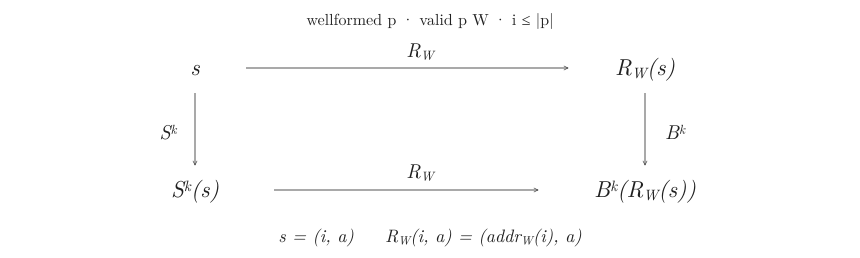

Span implements a branch relaxing assembler in Isabelle/HOL, with proofs of termination, minimum layout size and execution correspondence for a bytecode machine with signed 8-bit and 16-bit relative branches

## Correctness

An overflowing short branch must be wide in every valid assignment. [Relaxation](Relax.thy) computes the least widening set terminating on the number of remaining short branches. A final range check decides whether any valid layout exists

[Encoding](Encoding.thy) proves byte bounds and decoder inversion and [Execution correspondence](Machine.thy) relates source execution `S` and bytecode execution `B` through relocation `R` for every fuel bound (including suspended states)

Minimality assumes fixed instruction order and excludes alignment directives while the machine uses a natural valued accumulator and biased little endian branch payloads. The execution theorem starts from resolved instructions and excludes the SML compiler, runtime and OS I/O
